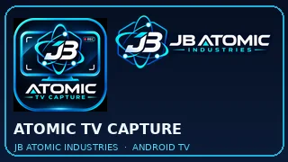

# ATOMIC TV Capture
### Android TV screenshots, screen recording and file transfer to PC or phone

**Android TV / Google TV · PNG screenshots · MP4 recording · Local browser dashboard**

[Français](README.md) · [English](README.en.md) · [Español](README.es.md) · [Русский](README.ru.md)

[**Download signed Android TV APK**](https://github.com/ElecktroSkwiiZz/atomic-tv-capture/releases/latest) · [Official releases](https://github.com/ElecktroSkwiiZz/atomic-tv-capture/releases) · [Official product page](https://jbatomic.com/atomic-tv-capture/)

## Overview

**ATOMIC TV Capture** by **JB Atomic Industries** is an Android TV and Google TV screenshot and screen-recording application. Use customizable remote-control shortcuts to capture the Android display, record videos, and download files from a computer or smartphone over the local network.

## Key features

- **PNG screenshots** using a configurable long press or remote-control button combination with the Accessibility service.
- **H.264 MP4 screen recording up to 1080p / 30 FPS**, **without audio**, with Android capture consent required for every session.
- **Local web dashboard** for computers and smartphones: manage, download or delete captured files, with individual downloads and ZIP export.
- **4-digit PIN**, rate-limited login, session protections and a configurable LAN port (**8766 by default**, with fallback).
- **French / English TV interface**, D-pad support and official signed GitHub update checks.
- Screenshots and exported videos have **no added watermark by default**.

## Download & installation

**Latest published version: v3.1.3.** [Download official signed APK](https://github.com/ElecktroSkwiiZz/atomic-tv-capture/releases/latest).

1. Install on an Android TV / Google TV device running **Android 11 or later**.
2. Enable **ATOMIC TV Capture** in **Settings → Accessibility** for remote-control shortcuts.
3. Configure your preferred capture shortcut in the app.
4. For file transfer, open the local address displayed on the TV from a computer or phone on the **same trusted LAN**, and enter the four-digit PIN.

## Compatibility and limitations

- External HDMI input from an Xbox, PlayStation or other connected console generally **cannot be captured** by Android screen-capture APIs.
- DRM-protected and `FLAG_SECURE` content may be black or blocked.
- MP4 recordings contain **no audio**; Android prompts for screen-capture authorization for each recording.
- Not every remote-control key can be intercepted.
- The local web dashboard uses **unencrypted HTTP**. Never expose its port to the public Internet or run it on an untrusted network.

## Frequently asked questions

**Can I take screenshots without a PC?** Yes, after configuring the remote accessibility shortcut.

**Can I download Android TV screenshots to Windows or my phone?** Yes, from the local browser dashboard.

**Does it record HDMI console gameplay?** Not normally. It captures the Android display, not the external HDMI video signal.

**Does the MP4 contain sound?** No, this version records video without audio.

## Project

**Package:** `com.jbatomic.tvcapture` · **Android:** API 30+ · **Build:** Java 17, Android SDK 35, Gradle 8.10.2.

[Changelog](CHANGELOG.md) · [Security](SECURITY.md) · [Privacy](PRIVACY.md) · [Release guide](PUBLICATION.md) · [Copyright](COPYRIGHT.md) · [ATOMIC TV Console](https://github.com/ElecktroSkwiiZz/atomic-tv-console).

© 2026 **[JB Atomic Industries](https://jbatomic.com/atomic-tv-capture/)**. No redistribution or reuse license is granted by default.
