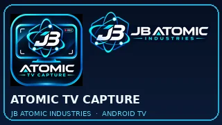

# ATOMIC TV Capture
### Capturas de pantalla, grabación de vídeo y transferencia de archivos en Android TV

**Android TV / Google TV · Capturas PNG · Vídeo MP4 · Panel web local**

[Français](README.md) · [English](README.en.md) · [Español](README.es.md) · [Русский](README.ru.md)

[**Descargar APK oficial firmada**](https://github.com/ElecktroSkwiiZz/atomic-tv-capture/releases/latest) · [Versiones](https://github.com/ElecktroSkwiiZz/atomic-tv-capture/releases) · [Página oficial](https://jbatomic.com/atomic-tv-capture/)

## Descripción

**ATOMIC TV Capture**, de **JB Atomic Industries**, permite hacer capturas de pantalla y grabaciones del sistema Android TV / Google TV mediante atajos configurables del mando. También puedes consultar y descargar archivos desde un PC o móvil en la misma red local.

## Funciones principales

- **Capturas PNG** con pulsación larga o combinación de teclas del mando mediante el servicio de accesibilidad.
- **Grabación H.264 MP4 hasta 1080p / 30 FPS**, **sin sonido**, con autorización de Android para cada sesión.
- **Panel web local** para gestionar y descargar archivos individualmente o en ZIP.
- **PIN de cuatro cifras**, control de intentos y puerto configurable (8766 por defecto).
- Interfaz para televisión **francés / inglés**, manejo con mando y actualizaciones APK oficiales firmadas.
- Archivos exportados **sin marcas de agua añadidas por defecto**.

## Instalación

[Descarga la última APK firmada — v3.1.3](https://github.com/ElecktroSkwiiZz/atomic-tv-capture/releases/latest). Se requiere **Android TV / Google TV con Android 11 o posterior**. Después de instalarla, activa **ATOMIC TV Capture** en **Ajustes → Accesibilidad**, configura el atajo de captura y consulta la dirección del panel en la pantalla de la televisión. Abre dicha dirección desde el navegador de un dispositivo conectado a la **misma red privada de confianza** e introduce el PIN.

## Limitaciones y seguridad

- La aplicación graba **la pantalla Android**, no normalmente el vídeo de dispositivos externos conectados por HDMI (Xbox, PlayStation, etc.).
- Los contenidos DRM o `FLAG_SECURE` pueden aparecer en negro.
- Las grabaciones MP4 **no incluyen audio**.
- Se requiere autorización de captura de Android para cada grabación.
- El panel usa **HTTP local sin cifrar**: nunca abras su puerto a Internet.

## Preguntas frecuentes

**¿Se pueden hacer capturas sin ordenador?** Sí, mediante los atajos del mando.

**¿Se pueden descargar al PC?** Sí, desde el panel web local.

**¿Graba la entrada HDMI de una consola?** Normalmente no, debido a las restricciones de Android.

## Proyecto

Paquete: `com.jbatomic.tvcapture`. Compilación: JDK 17, Android SDK 35 y Gradle 8.10.2.

[Historial](CHANGELOG.md) · [Seguridad](SECURITY.md) · [Privacidad](PRIVACY.md) · [ATOMIC TV Console](https://github.com/ElecktroSkwiiZz/atomic-tv-console).

© 2026 **[JB Atomic Industries](https://jbatomic.com/atomic-tv-capture/)**. Todos los derechos de código y recursos reservados salvo licencia explícita.
