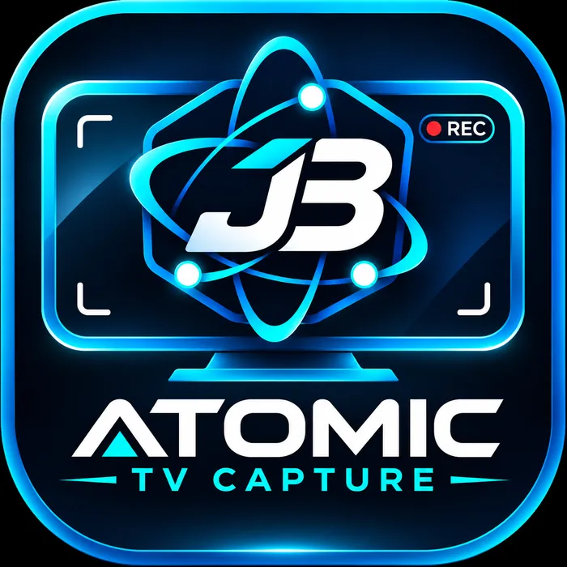

<div align="center">




# ATOMIC TV Capture

**Captures d'écran · Enregistrement vidéo · Transfert et contrôle depuis un PC**

**Éditeur : [JB Atomic Industries](https://jbatomic.com/)** · Android TV / Google TV · Version 3.1.1

</div>

ATOMIC TV Capture est une application Android TV destinée aux captures d'écran et à l'enregistrement vidéo du contenu affiché par le système Android. Son interface compacte s'utilise à la télécommande ; son tableau de bord web local permet de récupérer ou de gérer les fichiers depuis un PC.

## Identité visuelle officielle

ATOMIC TV Capture est édité par **JB Atomic Industries**. L'icône de l'application reprend le monogramme « JB », l'orbite cyan et les accents métalliques de l'identité visuelle de l'éditeur, avec un symbole de capture vidéo. Le logo de l'entreprise apparaît dans l'interface Android TV et le tableau de bord local sur PC. Les interfaces comportent une signature discrète, les sources des en-têtes d'identification et les documents les mentions de l'éditeur.

**Les captures d'écran et vidéos des utilisateurs ne sont jamais filigranées par défaut.** Aucun watermark ne doit être incrusté dans les fichiers exportés sans consentement et réglage explicites.

- [Logo officiel JB Atomic Industries](branding/jb-atomic-industries-official.webp)
- [Icône ATOMIC TV Capture](branding/atomic-tv-capture-official-logo.webp)
- [Bannière Android TV](branding/atomic-tv-capture-banner.webp)

## Fonctionnalités

- **Captures PNG** : appui long sur une touche programmable ou combinaison de deux touches, via le service d'accessibilité.
- **Enregistrement MP4** : H.264 jusqu'à 1080p / 30 FPS, sans audio. Chaque session nécessite l'autorisation système d'Android.
- **Télécommande ou PC** : déclenchement d'une capture, demande de démarrage / arrêt de la vidéo et consultation des fichiers depuis un navigateur.
- **Transfert local** : téléchargement individuel et ZIP en streaming ; suppression d'un fichier ou suppression totale avec confirmation.
- **Connexion au PC** : code à 4 chiffres, limitation des tentatives, cookie de session et protection contre les requêtes intersites.
- **Serveur local** : port configurable, tentative automatique sur un autre port si le port demandé est occupé (8766 par défaut).
- **Mise à jour GitHub** : vérification au lancement de l'application au maximum une fois par 24 h (option désactivable), ou vérification manuelle. Téléchargement d'une APK Release et contrôle de sa signature avant confirmation d'installation.

## Installation

1. Télécharger l'**APK Release signée** depuis les [Releases officielles GitHub](https://github.com/ElecktroSkwiiZz/atomic-tv-capture/releases/latest).
2. Installer l'APK sur la TV ou via ADB. Depuis le dossier qui contient `adb.exe` et l'APK :

   ```powershell
   # Remplace 192.168.X.X par l'adresse IP affichée dans les paramètres réseau de TA TV.
   .\adb connect 192.168.X.X:5555
   .\adb -s 192.168.X.X:5555 install -r ".\ATOMIC-TV-Capture-AndroidTV.apk"
   ```

3. Sur la TV, ouvrir **Paramètres → Accessibilité**, puis activer **ATOMIC TV Capture — raccourcis télécommande**.
4. Dans l'application, choisir la touche de capture ou la combinaison de touches, et relever l'URL ainsi que le PIN à quatre chiffres.
5. Depuis le PC, ouvrir dans le navigateur l'adresse indiquée sur l'écran de la télévision.

## Captures et limites

- Android 11 (API 30) minimum.
- Les contenus protégés (DRM, `FLAG_SECURE`) peuvent être inaccessibles ou noirs.
- Le flux HDMI d'une console externe branchée sur la TV n'est généralement pas accessible aux API Android de capture.
- Les touches HOME, POWER et d'autres touches réservées au système ne sont pas nécessairement interceptables.
- La vidéo ne contient pas le son ; l'autorisation de capture doit être confirmée sur la TV à chaque session.
- Le serveur PC est **HTTP local non chiffré** : ne l'exposez jamais sur Internet et utilisez-le uniquement sur un réseau local fiable. Android peut suspendre le serveur si la TV arrête l'application.

## Code source et versions

Pour compiler : JDK 17, Gradle 8.10.2, SDK Android 35. Commande : `gradle --no-daemon assembleDebug`.

**Identifiant Android permanent :** `com.jbatomic.tvcapture`. Ne le modifiez pas : Android s'en sert, avec la clé de signature, pour vérifier la compatibilité des mises à jour.

**Dépôt officiel :** [`ElecktroSkwiiZz/atomic-tv-capture`](https://github.com/ElecktroSkwiiZz/atomic-tv-capture). Les nouvelles versions de l'application sont distribuées via des **GitHub Releases** publiques. Une même clé de signature doit être utilisée pour toutes les Releases.

➡️ **Guide complet pour publier et automatiser les mises à jour : [PUBLICATION.md](PUBLICATION.md)**.

## Mentions

© 2026 **JB Atomic Industries** · [Site officiel](https://jbatomic.com/) · [Confidentialité](PRIVACY.md) · [Historique](CHANGELOG.md)

Aucune licence de redistribution/réutilisation du code n'est accordée par défaut. Définissez une licence explicite avant d'autoriser les contributions ou réutilisations tierces. N'ajoutez jamais de clés `.jks`, de mots de passe ou de fichiers privés au dépôt.

## Protection du code et attribution

Les versions **Release** activent R8 (minification, optimisation et réduction des ressources). Cela complique la lecture du binaire distribué, sans rendre le code source public inaccessible ni garantir l'absence de rétro-ingénierie. Les composants Android indispensables restent conservés pour assurer l'exécution.

Le tableau de bord local affiche le logo et de discrets filigranes de l'éditeur, avec des en-têtes HTTP de protection, sans apposer de logo sur les captures ou les vidéos. Consultez [COPYRIGHT.md](COPYRIGHT.md) et [SECURITY.md](SECURITY.md).
