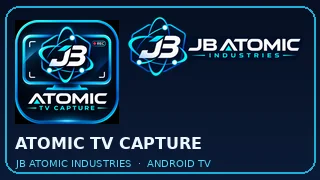

# ATOMIC TV Capture
### Скриншоты, запись экрана Android TV и передача файлов на ПК или телефон

**Android TV / Google TV · PNG · MP4 · Локальная веб-панель**

[Français](README.md) · [English](README.en.md) · [Español](README.es.md) · [Русский](README.ru.md)

[**Скачать официальную подписанную APK**](https://github.com/ElecktroSkwiiZz/atomic-tv-capture/releases/latest) · [Релизы](https://github.com/ElecktroSkwiiZz/atomic-tv-capture/releases) · [Сайт приложения](https://jbatomic.com/atomic-tv-capture/)

## О приложении

**ATOMIC TV Capture** от **JB Atomic Industries** позволяет делать скриншоты и записывать экран Android TV / Google TV с помощью настраиваемых сочетаний кнопок пульта. Файлы можно скачать через браузер ПК или смартфона в одной локальной сети.

## Возможности

- **Скриншоты PNG** по долгому нажатию или комбинации кнопок через службу специальных возможностей Android.
- **Запись экрана H.264 MP4 до 1080p / 30 FPS**, **без звука**, с подтверждением Android перед каждой записью.
- **Локальная веб-панель** для просмотра, загрузки отдельных файлов и ZIP-архивов, а также управления файлами.
- Четырёхзначный PIN с ограничением попыток входа, настраиваемый порт (8766 по умолчанию).
- Телевизионный интерфейс на французском и английском, управление пультом, официальные подписанные обновления.
- Экспортированные скриншоты и видео **без добавленного водяного знака по умолчанию**.

## Установка

[Скачать последнюю подписанную APK — v3.1.3](https://github.com/ElecktroSkwiiZz/atomic-tv-capture/releases/latest). Требуется **Android TV / Google TV с Android 11 или новее**. После установки включите службу **ATOMIC TV Capture** в **Настройки → Специальные возможности**, настройте сочетание для скриншота и откройте локальный адрес, показанный телевизором, в браузере устройства в **той же доверенной сети**. Введите PIN.

## Ограничения и безопасность

- Приложение записывает **экран Android**, но обычно **не может записывать внешний HDMI-сигнал** игровой приставки.
- Защищённое DRM и `FLAG_SECURE` содержимое может отображаться чёрным.
- Видео MP4 **не содержит звуковой дорожки**.
- Каждая запись экрана требует разрешения Android.
- Веб-панель использует **незашифрованный HTTP**. Никогда не открывайте её порт в Интернет.

## Вопросы

**Можно ли сделать скриншот без компьютера?** Да, с помощью настроенного сочетания кнопок пульта.

**Можно ли скачать снимки на ПК?** Да, через локальную веб-панель.

**Можно ли записывать игры с внешней приставки по HDMI?** Обычно нет, из-за ограничений Android.

## Проект

Пакет: `com.jbatomic.tvcapture`. Сборка: JDK 17, Android SDK 35, Gradle 8.10.2.

[История версий](CHANGELOG.md) · [Безопасность](SECURITY.md) · [Конфиденциальность](PRIVACY.md) · [ATOMIC TV Console](https://github.com/ElecktroSkwiiZz/atomic-tv-console).

© 2026 **[JB Atomic Industries](https://jbatomic.com/atomic-tv-capture/)**. Права на исходный код и оформление сохраняются за правообладателем, если не указано иное.
